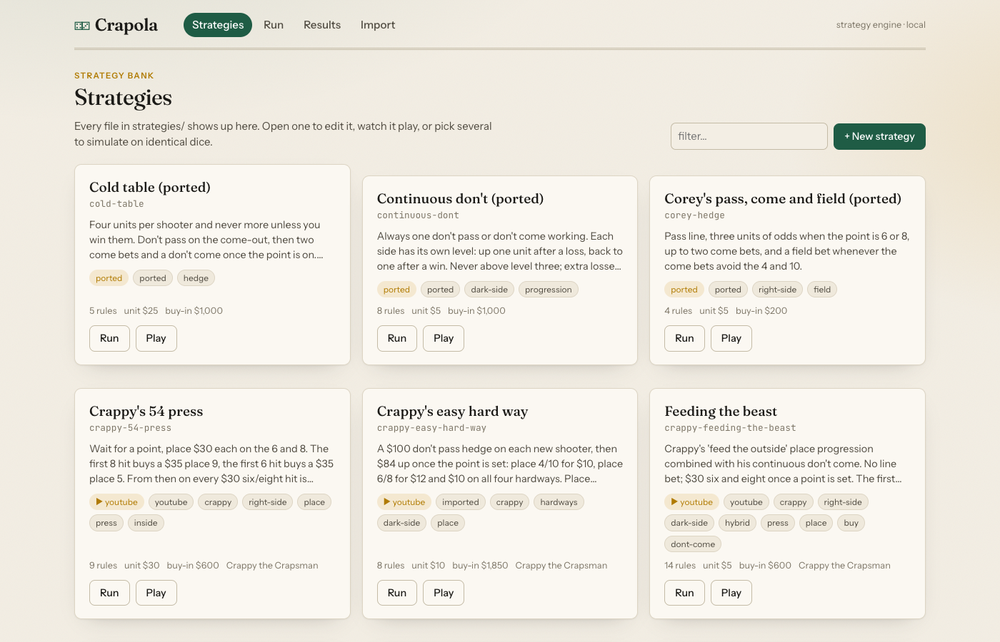
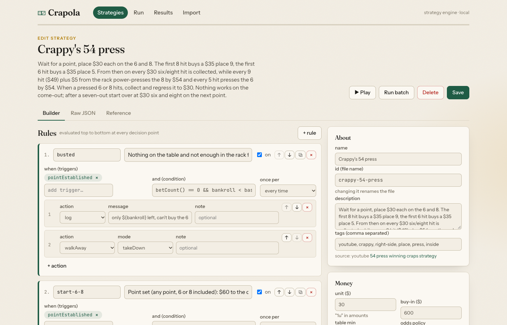
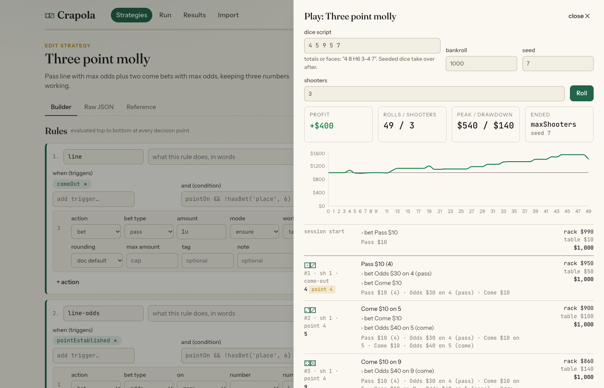
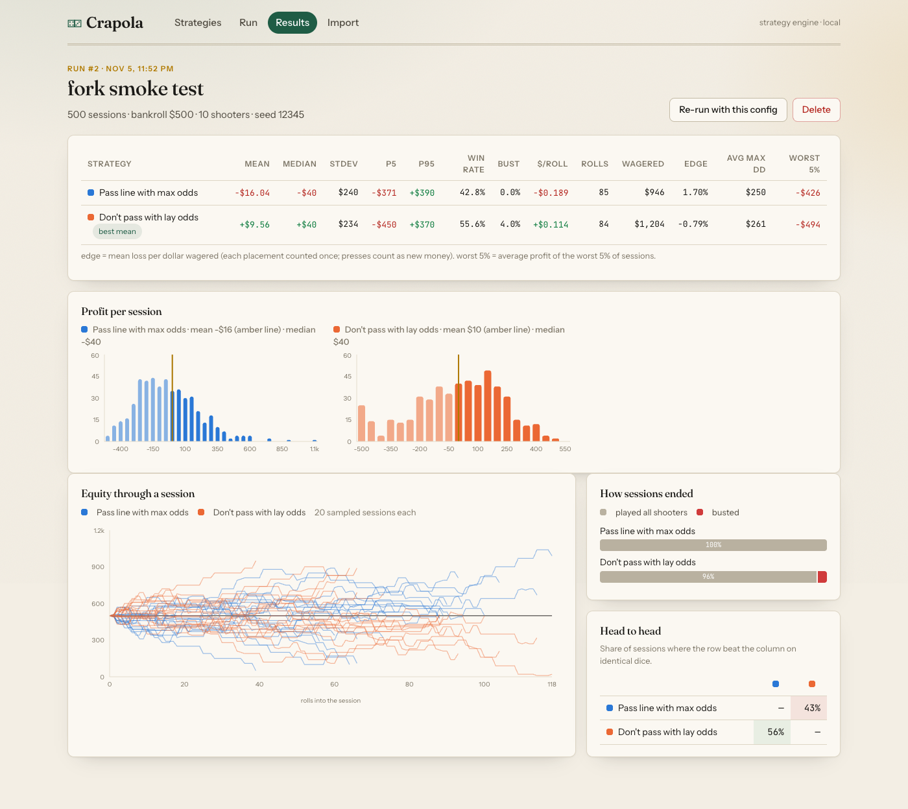

# crapola

A craps strategy engine and simulator. Describe a betting system as a small JSON document, run it through thousands of sessions on identical dice, and compare it against other systems. Strategies can be written by hand, built in the web UI, or imported from a YouTube video with the `/import-video` Claude Code skill.

```
bun install
bun run cli list
bun run cli run pass-line-max-odds three-point-molly iron-cross --sessions 10000
bun run cli play crappy-54-press --dice "4 6 8 6 5 9 7"
bun run web          # http://localhost:5173
```

## Requirements

- [Bun](https://bun.sh) 1.2 or newer. Everything runs through it; no Node or npm needed.
- [uv](https://docs.astral.sh/uv/) only for fetching YouTube transcripts (it runs yt-dlp through `uvx`).
- tmux is optional but the dev-server convention here uses it.

## Documentation

| doc | read it when |
|---|---|
| [docs/strategy-dsl.md](docs/strategy-dsl.md) | you are writing or reading a strategy file: every field, trigger, action, identifier and function |
| [docs/writing-strategies.md](docs/writing-strategies.md) | you want to encode a system by hand or in the UI: patterns, amounts, how to check it plays right |
| [docs/importing.md](docs/importing.md) | you want to turn a video into a strategy with the `/import-video` skill |
| [docs/architecture.md](docs/architecture.md) | you want to know how a roll is processed, how exits work, why results are reproducible |
| [docs/extending.md](docs/extending.md) | you are adding a bet type, action, trigger, statistic, rule or page |
| [apps/web/README.md](apps/web/README.md) | the web app's pages, API routes and layout |
| [packages/engine/README.md](packages/engine/README.md) | using the engine from code, including TypeScript strategies |
| [packages/store/README.md](packages/store/README.md), [packages/cli/README.md](packages/cli/README.md) | the store and CLI surfaces |

## Layout

| path | what |
|---|---|
| `packages/engine` | the game: dice, table rules, every standard bet, bankroll accounting, the strategy DSL interpreter, batch runner and statistics. Zero dependencies besides zod. |
| `packages/store` | strategy files on disk (`strategies/*.json`) and saved runs in SQLite (`data/crapola.sqlite`, via `bun:sqlite`). |
| `packages/cli` | `bun run cli ...` |
| `apps/web` | Vite + React UI with a Hono API: strategy builder, single-session player, batch runs with charts and head-to-head comparisons. |
| `strategies/` | the strategy bank. Classics, ports of the old Python sims, and imports from Crappy the Crapsman's channel. |
| `docs/` | guides and the DSL reference (see Documentation above). |
| `.claude/skills/import-video` | the Claude Code skill that turns a video transcript into a strategy file. |

## How a simulation works

- Every session has its own seed. Session `i` of every strategy in a run uses the same seed, so strategies are compared on identical dice (common random numbers). The head-to-head table in the results counts how often each strategy out-earned another on the same rolls.
- A session ends on the configured number of shooters (default 10), a roll cap, a stop loss, a win goal, a bust, or when the strategy walks away. Removable bets come down when leaving; contract bets ride until they resolve.
- Payouts are floored to whole dollars like a real table. Place, buy and hardway bets are off on the come-out unless the strategy says otherwise; lay bets and don't odds always work; come odds are off on the come-out. Buy and lay vig is charged on wins by default. All of this is configurable per strategy or per run.
- The engine is checked against known house edges (pass 1.41%, don't pass 1.36%, place 6 1.52%, field 2.78%, hard 8 9.09%, and so on) in `packages/engine/test/edge.test.ts`.

## Strategy documents

See `docs/strategy-dsl.md`. The short version:

```json
{
  "version": 1,
  "id": "place-6-8-press",
  "name": "Place 6 and 8, press once",
  "unit": 6,
  "bankroll": 300,
  "rules": [
    { "on": "pointEstablished", "do": [{ "action": "bet", "type": "place", "numbers": [6, 8], "amount": "2u" }] },
    { "on": "betWon:place", "when": "bet.amount < 24", "do": [{ "action": "press", "target": "self" }] },
    { "on": "sevenOut", "do": [{ "action": "log", "message": "shooter {shooter} done, profit {profit}" }] }
  ]
}
```

Rules run in order at every decision point (session start and after each roll). `on` picks the triggers, `when` is an expression over table and bankroll state, `do` is a list of actions: `bet`, `press`, `regress`, `takeDown`, `setWorking`, `set`, `increment`, `sitOut`, `walkAway`, `log`. Variables hold progression state such as Martingale levels.

For anything the DSL can't say, a strategy can also be a TypeScript object implementing `Strategy` from `@crapola/engine` (see `packages/engine/test/session.test.ts` for examples).

## CLI

```
bun run cli list
bun run cli validate <id|file>
bun run cli run <id> [id...] [--sessions 10000] [--bankroll 1000] [--shooters 10] [--seed 12345]
                             [--unit U] [--rolls R] [--stop-loss L] [--win-goal G] [--table-min M] [--odds 3-4-5x]
                             [--save [name]] [--csv file] [--json]
bun run cli compare <id> <id> [...]          same as run with several strategies
bun run cli play <id> [--dice "4 8 H8 6-6 7"] [--seed S] [--shooters N]
bun run cli transcript <youtube url or id> [--out file]
bun run cli runs                              saved runs
bun run cli export <runId> <file.csv>
bun run cli schema | docs
```

Dice scripts take totals (`8`), explicit dice (`4-4`), or hardways (`H8`); `10`, `11`, `12` are totals, so write `1-1` for aces.

## Importing a strategy from YouTube

In Claude Code, inside this repo:

```
/import-video https://www.youtube.com/watch?v=pC3Xdger1WY
```

The skill fetches the transcript (yt-dlp through `uvx`, so `uv` must be installed), translates it into a strategy document, validates it, plays it through scripted dice, runs a batch, and saves it to `strategies/`. Assumptions it had to make are recorded in the document's `notes`.

## Web UI

```
bun run web
```

Starts the Hono API on port 4242 and the Vite dev server on port 5173 (or the next free port). See `apps/web/README.md` for the pages and API routes.






## The strategy bank

| id | what | source |
|---|---|---|
| `pass-line-max-odds` | pass line, 3-4-5x odds | classic |
| `dont-pass-lay-odds` | don't pass, max lay odds | classic |
| `three-point-molly` | pass plus two come bets, all with max odds | classic |
| `place-6-8` | two units on the 6 and 8 | classic |
| `iron-cross` | place 5, 6, 8 and the field every roll | classic |
| `pass-line-horn-hedge` | pass line with a horn on the come-out, hardways and a late any-seven | classic |
| `double-dont` | Martingale on the don't pass, bail past level four | classic |
| `continuous-dont` | one don't pass or don't come always working, levelled progression | port of the old Python sim |
| `cold-table` | four units per shooter: don't pass, two comes, a don't come | port |
| `corey-hedge` | pass, odds on 6/8, two comes, field hedge | port |
| `crappy-54-press` | $30 six and eight, first hits buy the 5 and 9, 5/9 hits press the 6/8 by $54, regress on a pressed hit | Crappy the Crapsman |
| `crappy-easy-hard-way` | $100 don't pass hedge, place 4/6/8/10 with hardways behind them, easy hits re-buy the hardway | Crappy |
| `crappy-feeding-the-beast` | $30 six and eight, winnings spread to the outside, then every green to a don't come | Crappy |
| `crappy-hedgie-wedgy` | doey-don't with a hop 12, lay odds sized to win the flat, one don't come covered by a yo | Crappy |
| `crappy-place-to-lay` | lay the 6 and place the 8 at $120, step up on a 6, after an 8 regress into $110 inside and build across | Crappy |

Every imported document records its video under `source` and the importer's assumptions under `notes`. Between them the bank exercises pass, don't pass, come, don't come, odds both ways, place, buy, lay, field, hardways, horn, hop and any-seven on both the come-out and later rolls; the kitchen-sink test in `packages/engine/test/coverage.test.ts` places all 22 bet types through the DSL.

## Reading the numbers

- `mean`, `median`, `p5`, `p95` are session profits in dollars over the configured shooters.
- `win%` is the share of sessions that ended ahead; `bust%` the share that ran out of money. A strategy whose minimum buy-in is above the table minimum can stall with a few chips left instead of busting; give it a `walkAway` rule or a stop loss if that matters.
- `edge` is mean loss divided by dollars put at risk, where a place bet counts once no matter how many rolls it sits through. That is why place strategies show a larger number than the textbook per-decision edge (1.52% on the 6 and 8). Use it to compare strategies with each other, not against the textbook.
- `$/roll` is the most honest cross-strategy number: expected profit per dice roll at the table.
- The head-to-head matrix uses the same dice for every strategy, so it answers "which system would have done better on these rolls" without sampling noise between them.

## Tests

```
bun test
bunx tsc -p tsconfig.json --noEmit
```

## Where this came from

Two earlier attempts live next door: `../craps-sim` (a wrapper around the `crapssim` Python library with a few custom strategies and pandas analysis) and `../crapy` (a from-scratch Python engine). The custom strategies from the first one are ported here as `continuous-dont`, `cold-table` and `corey-hedge`.
